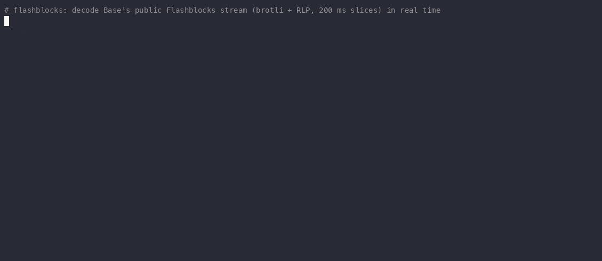

# flashblocks

Chainlink price updates on Base as they land: the new answer decoded from the transmit transaction and confirmed
from the block's `logs_bloom`, with no receipt round-trip.

Rust library, command-line tool and Python module (`pip install flashblocks`).



## Base after Denim (0.2)

On Nov 5, 2026 Base activated Denim: a complete canonical block every 200 ms, and Flashblocks were retired
(`wss://mainnet.flashblocks.base.org/ws` still accepts connections but streams nothing). Since 0.2 this crate reads
200 ms blocks from any WebSocket RPC with subscriptions:

* **Header first.** `eth_subscribe("newHeads")` delivers every block header with its `logsBloom`. A block is read only
  if the bloom holds the `AnswerUpdated` topic and one of the watched aggregators; blooms have no false negatives, so
  nothing is missed and almost no block is read for nothing (in a live test: one block read in four minutes, the one
  with the update).
* **No dropped blocks.** Public WebSocket endpoints drop headers under load (on the day after Denim one public stream
  delivered 59% of the blocks). The listener remembers the last block it saw and reads every skipped one by number
  over the same connection, including the blocks of a reconnect.
* **Same events.** The block's transactions are decoded exactly as Flashblocks slices were: `forward(aggregator,
  transmit(report))` through a forwarder or a direct `transmit(report)`, the new answer is the median of the report's
  observations (as the OCR2 aggregator computes it), and `AnswerUpdated(aggregator, answer)` in the block's bloom
  confirms it. `index` is now the transaction index in the block.

A Flashblocks stream can still be decoded (`Listener`, `parse`, `--url`) for chains or nodes that serve one.

## Command line

```bash
cargo install flashblocks
flashblocks-tail --feed 0x71e021bc2e8a709b72ac7b6036e5b2bf30f263d0   # cbETH/USD aggregator on Base
```

```text
{"block":54360494,"index":7,"aggregator":"0x92f88cca9d3c846be7e8163e4c32bb07772cd245","answer":"7587667500230","confirmed":true,"tx":"0xf9f9…","latency_ms":165.67}
```

`--feed` is the **aggregator** address (what `EACAggregatorProxy.aggregator()` returns), not the proxy; pass it as many
times as you like. `--rpc wss://…` sets the WebSocket RPC (default: the public `wss://base-rpc.publicnode.com`); for
anything serious use your own node or a provider from Base's Builder Stack. `latency_ms` is the time from the header's
arrival to the printed line, which includes reading the block over the RPC (~150 ms on a public endpoint). One JSON line
per update goes to stdout; when the chain is quiet, connection statistics (blocks read, skipped blocks filled) go to
stderr.

## Rust

```rust
use flashblocks::{BlockListener, Watch};

let watch = Watch { aggregators: vec![cb_eth_usd] };
let listener = BlockListener::start("wss://base-rpc.publicnode.com".into(), watch);
for update in listener.receiver.lock().unwrap().iter() {
    let f = update.update;
    println!("block {} tx {} feed 0x{} confirmed {:?} after {:.2} ms",
             f.block, f.index, hex::encode(f.aggregator), f.confirmed,
             update.received.elapsed().as_secs_f64() * 1000.0);
}
```

Without the listener: `flashblocks::blocks::may_have_update(&header, &watch)` checks a header's bloom and
`flashblocks::blocks::block_updates(&block, &watch)` decodes a full block (`eth_getBlockByNumber(n, true)`), both on
`serde_json::Value`. `BlockListener.watch` can be swapped at runtime.

## Python

```bash
pip install flashblocks
```

```python
import flashblocks

listener = flashblocks.BlockListener("wss://base-rpc.publicnode.com",
                                     aggregators=["0x71e021bc2e8a709b72ac7b6036e5b2bf30f263d0"])
while True:
    got = listener.next(1000)  # (aggregator, answer, block, tx_index, age_ms, tx_hash, confirmed) or None
    if got:
        print(got)
```

`flashblocks.block_updates(block_json, aggregators)` decodes a block you fetched yourself. Decoding and waiting run
with the GIL released. `flashblocks.Listener` and `flashblocks.parse` still read a Flashblocks stream.

## Testing

`cargo test --release` decodes a recorded Base mainnet block with a cbETH/USD update (block 53935243, confirmed from its
bloom), checks the header prefilter, and replays `tests/fixtures/base_sample.ndjson` (135 Flashblocks messages from
October 2026) against an independent Python decoder. Selectors are derived from the function signatures in a test, so
a typo cannot silently break decoding.

## License

MIT.
